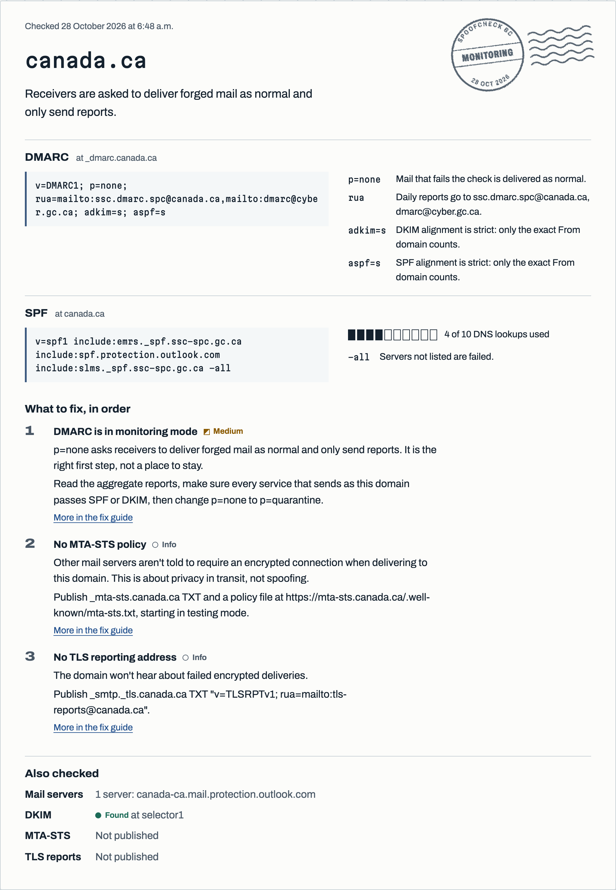

# SpoofCheck BC

SpoofCheck BC reads the public DNS records of B.C. public bodies and reports how well each domain is protected against forged email. It's for residents and reporters who want the overall picture, and for IT staff who want to know exactly what to change.

Live site: https://spoofcheck-bc.vercel.app



## Why I built this

Scam emails that pretend to come from a city hall, a school district or a health authority work because people trust those names. Whether a forged message gets refused, filed as spam or delivered depends partly on three DNS records the real organization controls: SPF, DKIM and DMARC.

Federal departments have to publish all three, and the federal government already tracks its own domains. I couldn't find anyone doing the same for B.C.'s municipalities, regional districts, school districts and health authorities, so that's the gap this project fills.

The first real scan of 20 large bodies surprised me in two ways. None of them were fully unprotected, but only 4 were at `p=reject`; most stopped at quarantine or at monitoring. And 9 of the 20 SPF records already use 7 or more of the 10 DNS lookups SPF allows, so one more mailing service could break SPF for them.

## What it checks

DMARC sets each domain's level: ENFORCED, PARTIAL, MONITORING or UNPROTECTED. SPF (including lookup counting through nested includes), MX, MTA-STS, TLS reporting and a probe of common DKIM selectors add findings without changing the level. Every finding has a code, a severity, a plain explanation and a fix; the full list is in [docs/FINDINGS.md](docs/FINDINGS.md).

## How it works

```
data/inventory.csv
        |
spoofcheck (Python)
  cli.py -> scanner.py -> resolver.py (dnspython, async, 4 in flight)
              dmarc.py  spf.py  mx.py  transport.py  dkim.py
  store.py (SQLite, local only)   snapshot.py -> data/snapshots/*.json
  site/build.py (Jinja2) -> static site

web/check.js -> DNS-over-HTTPS (dns.google), same rules in the browser
```

The hardest part was SPF lookup counting. Receivers stop after 10 DNS lookups, and the count includes everything inside included records, so the checker has to walk every `include` and `redirect`, count `a`, `mx`, `ptr` and `exists` along the way, count lookups that return nothing, and stop on loops. The rules live twice, in Python for the weekly scan and in JavaScript for the checker on the site, and keeping the two in agreement was the other tricky bit.

That's what the shared test vectors in [tests/vectors/](tests/vectors/) are for. Each case is a small fake DNS zone plus the expected level and findings. `pytest` and `node --test` both load the same files, so a rule can't change in one language without failing in the other. Unit tests never touch the network; DNS and the MTA-STS fetch are faked. CI runs ruff, mypy (strict), pytest and the Node tests on every push.

## Ethics and limits

It reads public DNS records and, when a domain says it has one, its public MTA-STS policy file. It never connects to a mail server, never sends email and never scans anything. Scans run once a week with at most four lookups in flight.

The public site only shows totals by sector. A ranked list of named organizations wouldn't help anyone fix anything and would point attackers at the weakest domains. Each organization can get its own results privately: `spoofcheck disclose "<name>"` prints a short note for its IT team.

The weekly snapshot files are committed so the site can show a trend, but they contain no names. Each domain's level is stored under `HMAC-SHA256(key, domain)`. A plain hash wouldn't hide anything, because the list of domains is public and short enough to hash and match; without the key, the snapshot can't be reversed.

It can't tell you whether a body's own mail filters catch forgeries, whether DKIM is set up under a selector name it didn't try, or whether every legitimate sender passes. Only the organization's DMARC reports show that.

## Run it yourself

```bash
uv sync
uv run spoofcheck check example.ca
```

Other commands: `scan`, `diff`, `snapshot` (needs `SNAPSHOT_KEY` in the environment or `.env`), `build-site --out site/`, `disclose "<organization>"` and `inventory check`. Browser checker tests: `node --test web/*.test.js`.

## What I'd do next

- Verify every domain in the inventory against the organization's own website and grow the list toward all of B.C.'s local governments and school districts.
- Add universities and colleges.
- Parse DMARC aggregate reports for organizations that opt in, so they can see which senders would fail before moving to `p=reject`.

## Built with

Python, dnspython, Typer, Jinja2, httpx, plain JavaScript and hand-written CSS. I wrote the spec, the design reference and the test vectors and made the design decisions; I used Claude Code to implement the milestones, then reviewed and revised the code.

Independent student project. Not affiliated with the Government of British Columbia or any organization listed.
